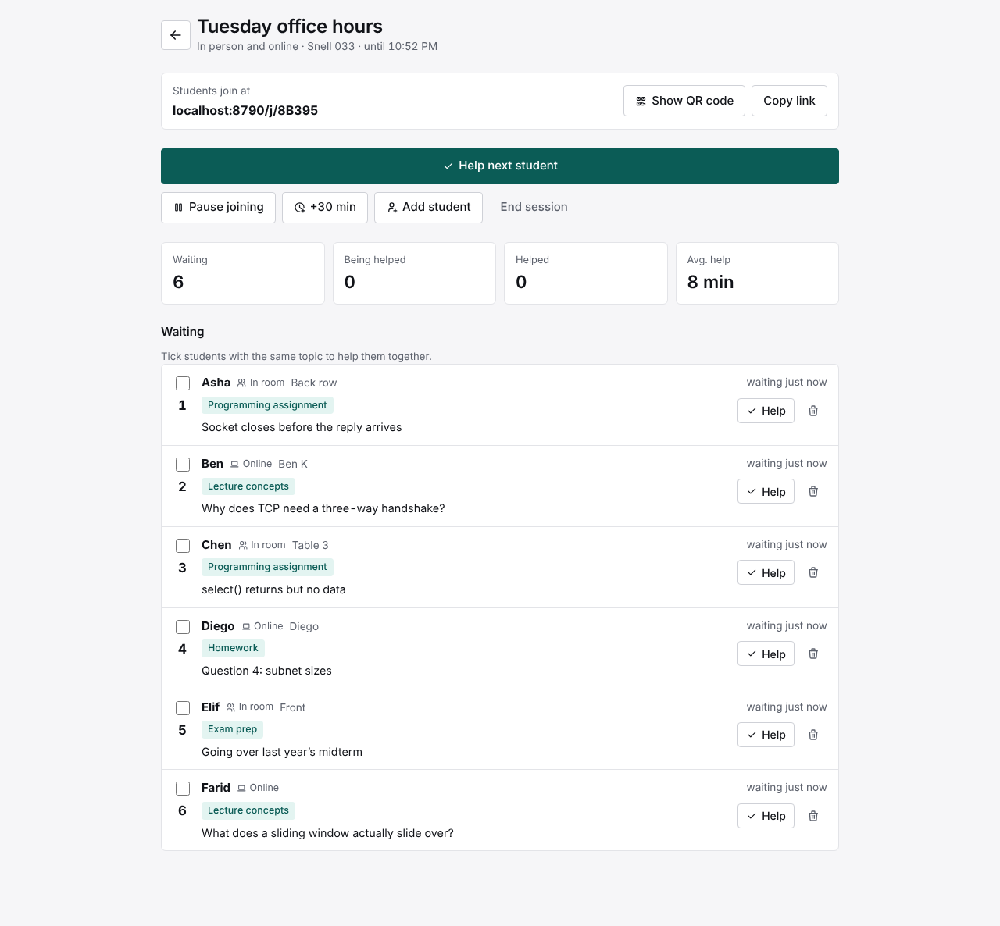
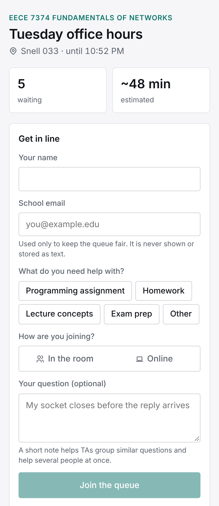
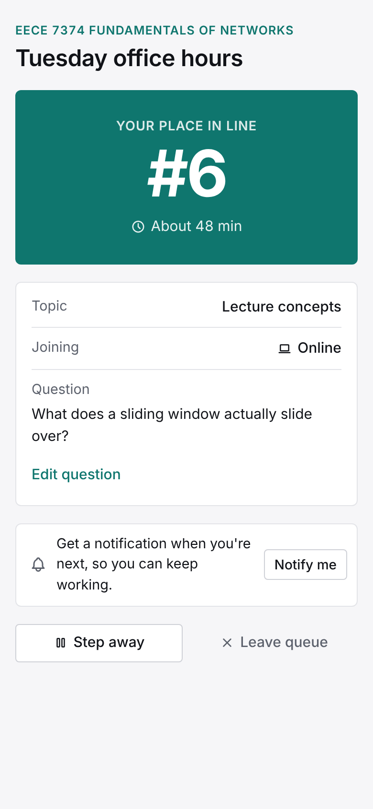
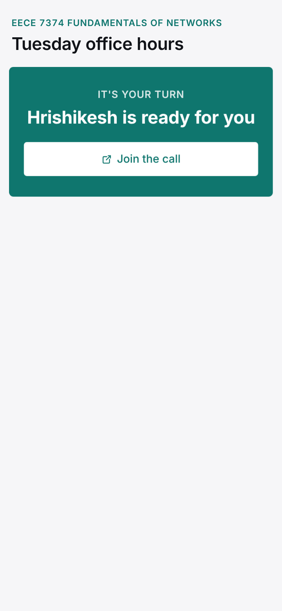
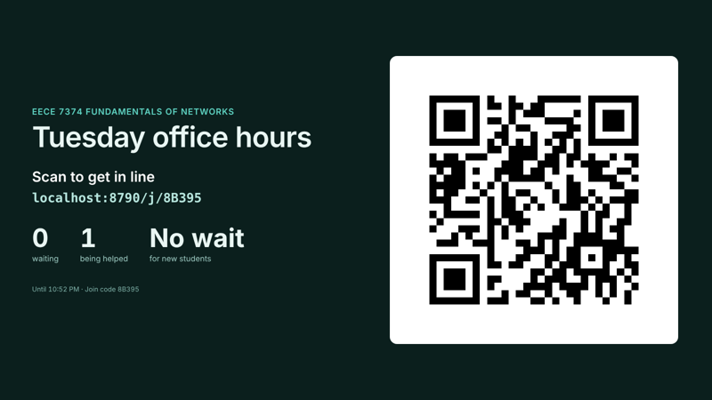

# Office Hours Queue

A fair queue for office hours where some students are in the room and some are online. Students scan a QR code or open a link, see their live place in line, and get a notification when it's their turn. TAs work through one queue for everyone. Built for the office hours of a networking course I TA, and it runs free on Cloudflare.



## The problem

Students got in line two ways: some emailed, some showed up. TAs juggled both, nobody knew how long the wait was, and the same few students could take most of a session.

## What it does

**For students**
- Join in seconds from a QR code or link, on any phone, with no account.
- See their live place in line and an estimated wait, updated every few seconds.
- Step away without losing their place, edit their question, or leave.
- Get a push notification when they're next and when it's their turn, or a chime, vibration and flashing tab if they keep the page open. The meeting link appears only when it's their turn.

**For TAs**
- One queue for in-person and online students: **Help next student**, or pick someone specific.
- **Group help:** tick students with the same topic and help them together.
- **Not here** puts a no-show back in line at the same place. **Add student** covers people who emailed.
- Pause joining near closing time, or extend the session.
- A **projector screen** with a large QR code and the queue length, never names.
- **Anonymous statistics** after each session, including the topics students needed help with most, which is useful to share with the instructor.

| Join | Waiting | Your turn | Projector |
| --- | --- | --- | --- |
|  |  |  |  |

## Design decisions

**A visible fairness rule.** Students already helped this week wait 15 extra minutes per earlier visit (configurable, or off). It moves repeat visitors back without blocking them, and the student sees why, so the rule feels fair instead of arbitrary.

**Honest wait estimates.** The estimate uses this session's real average help time (8 minutes until there's data) and the number of TAs active in the last 20 minutes, and a group help counts once.

**No double-booking.** Two TAs clicking the same student at the same moment can't both claim them: the claim only succeeds if the ticket is still waiting, checked in the same database write.

**Privacy by default.** Emails are never stored. The app keeps only a keyed fingerprint (HMAC) of each email, enough to apply the weekly fairness rule. Names, questions and seats are erased a day after each session; the anonymous timing and topic data stays for statistics.

**A QR encoder with no dependencies.** The projector's QR code comes from a small encoder written for this project (byte mode, error-correction level M, versions 1 to 10), checked against an independent decoder: OpenCV decodes every version (`docs/verify-qr.py`), and a test pins the verified output.

**Live without WebSockets.** Pages refresh every 4 seconds while visible and pause when hidden. For a room of 10 to 30 students, that's simpler than persistent connections and well within the free plan.

## Security

- TA sign-in with email and a 6-digit PIN, hashed with a secret pepper and rate limited (5 tries per account and 30 per network address per 15 minutes). Invite links work once and expire after 7 days.
- Student tickets use an unguessable token in an HttpOnly cookie; a student can only see and change their own ticket.
- Every write checks the request's Origin (CSRF), and the app sends a strict Content-Security-Policy.
- Meeting links must be `https://`, and push subscriptions must point to a real browser push service, so the server can't be aimed at other hosts.
- Students' join requests are rate limited, and each queue is capped at 200 people.

## Tech

TypeScript throughout. React frontend, installable as an app (PWA). Cloudflare Workers with a D1 (SQLite) database and a 15-minute scheduled job that closes overrun sessions and erases old names. Web Push implemented on the Web Crypto API (RFC 8291 encryption, RFC 8292 VAPID), with no push service fees. Monthly cost: $0.

## Run it locally

```
npm install
npm test
npm run demo      # a demo course with five students waiting
npm run build
npm run local     # http://localhost:8787
```

Sign in as a TA at `/staff` with `ta@example.edu` and PIN `246810`. The demo prints its join code; open `/j/<code>` in another browser to join as a student.

## Tests

32 tests with Node's built-in test runner: the fairness rule and week boundaries in the course's time zone, wait estimates, simultaneous claims, group help, stepping away, re-queueing, privacy erasure, rate limits, access control, CSRF, push subscription validation, push encryption, and the QR encoder.

## Deploying

See [DEPLOY.md](DEPLOY.md). Secrets are created and uploaded with one command.

## Known limitations

- Student emails aren't verified (no email sending, to stay free). Joining requires the course's email domain, and TAs can remove anyone.
- iPhones only show web notifications for apps added to the Home Screen (iOS 16.4+). Without that, the page chimes while it's open.
- Live updates arrive within about 4 seconds, not instantly.

## License

MIT
